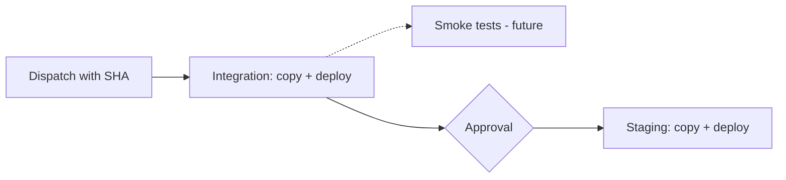

# ECS Deployment to Integration and Staging

Interim documentation. This is a first step towards full CI/CD deployment management.

## Current State

This workflow is **manually dispatched only**. You trigger it manually and provide a git SHA. No automatic deploys.

The workflow copies the Docker image from GitHub Container Registry to the integration AWS account ECR, then updates the ECS task definition and deploys to the integration cluster with rolling restart.

Once integration succeeds, the same image is promoted to staging after manual approval.

Requires valid 40-character git SHA of an image already in GHCR.

## What This Does

1. Takes a Docker image SHA from GHCR (already built and in registry)
2. Copies image to integration account ECR
3. Registers new task definition with the image
4. Updates ECS service with rolling restart (new tasks replace old ones gradually)
5. Health checks happen before old tasks are stopped
6. Waits for approval on the `staging` GitHub environment
7. Repeats steps 2 to 5 against the staging account

## How To Use

Manual workflow dispatch in GitHub Actions. Provide the full git SHA of the image you want to deploy.

After integration deploys, the staging job shows as "Waiting". A required reviewer clicks **Review deployments** on the run page and approves or rejects.

Required reviewers are configured in repo **Settings > Environments > staging**. The staging role ARN is read from the `STAGING_DEPLOYER_ROLE_ARN` secret.

## Future Direction

In the near future, we will move to an ECR-only workflow. This means:
- Tagging and release process will be recreated
- Managing task definitions and tagged artifacts consistently across environments

Production will be introduced in a deliberate fashion once staging is working well.

Eventually the goal is:
- Deployments to integration trigger smoke tests that gate promotion to staging (placeholder comment in the workflow marks where)
- Full CI/CD pipeline manages task definitions and tagged artifacts
- Unified deployment strategy across integration, staging, and production

## Monitoring Deployment

Check AWS console under ECS cluster `integration` or `staging`, service `datagovuk` to watch tasks being replaced.

Or tail logs in CloudWatch at `/ecs/integration/datagovuk` or `/ecs/staging/datagovuk`.